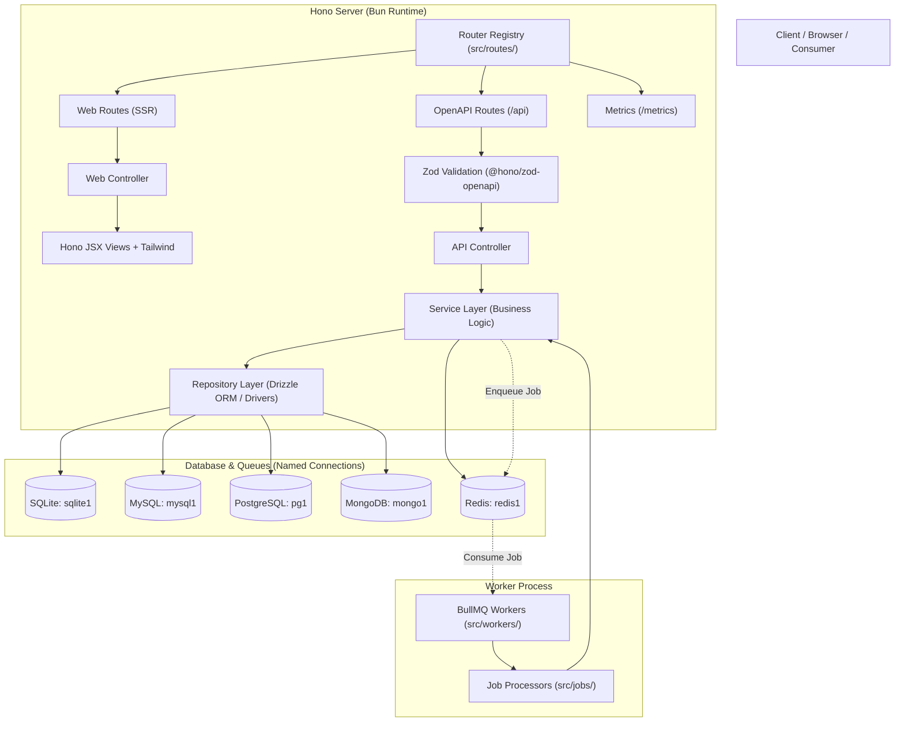

# Documentation

Welcome to the official documentation for the **Hono Multi-Database API Skeleton**.
This repository provides a modern backend and fullstack starter kit built with **Bun**, **Hono**, **Drizzle ORM**, **Tailwind CSS (Vite)**, and **BullMQ (Redis)**, featuring out-of-the-box multi-database support (SQLite, MySQL, MongoDB, and PostgreSQL).

---

## 📚 Documentation Sections

The documentation is organized by practical purpose:

### 🚀 1. [Getting Started](./getting-started/README.md)
Initial setup guide to get the skeleton running locally and in production.
- [Overview](./getting-started/README.md)
- [Installation & Setup](./getting-started/installation.md) — Runtime installation, single `.env` setup, migrations, and running the app.
- [Deployment](./getting-started/deployment.md) — Compiling Tailwind CSS, Bun standalone binary, and production server setup.

### 📖 2. [Guides](./guides/make-cli.md)
Workflow-oriented operational guides.
- [Make CLI](./guides/make-cli.md) — Stub-based code generation (controllers, services, repositories, validations, jobs, etc.).
- [Migrations](./guides/migrations.md) — Multi-engine database migration runner with explicit target connections.
- [Seeders](./guides/seeders.md) — Database seeder runner with multi-target support.
- [Queues & Workers](./guides/queues.md) — Asynchronous background jobs via BullMQ & Redis.
- [Mail System](./guides/mail.md) — Laravel-style Mailable architecture, Hono JSX email templates, multi-driver transports, and BullMQ queue integration.
- [Logging](./guides/logging.md) — Structured JSONL logging, buffered write streams, and context tracing.
- [Metrics](./guides/metrics.md) — Prometheus metrics (`/metrics`), latency histograms, and authentication tokens.

### 📐 3. [Standards](./standards/README.md)
Architecture rules and code conventions for this repository.
- [Architecture Standard](./standards/architecture.md) — Layering (`Routes -> Validations -> Controllers -> Services -> Repositories`), Web vs API boundaries.
- [Code Conventions](./standards/conventions.md) — Naming conventions, explicit `.ts` imports, response formatting, and logging tags.
- [API Patterns](./standards/api-patterns.md) — Step-by-step guide to adding new modules with OpenAPI validation.
- [Error Handling](./standards/error-handling.md) — `AppError` class hierarchy, automated error normalization, and driver error translation.

### 🔍 4. [Reference](./reference/README.md)
Stable technical facts, directory trees, and connection specifications.
- [Architecture Overview](./reference/architecture-overview.md) — Full system overview, actual directory structure, and default endpoints.
- [Connection Model](./reference/connection-model.md) — Named multi-connection model (`sqlite1`, `mysql1`, etc.) and fallback mechanisms.
